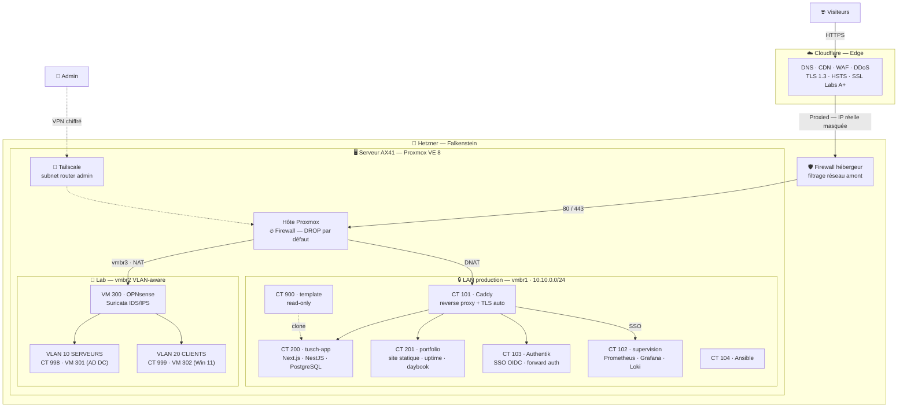

# tusch-infra

**Infrastructure auto-hébergée production-grade.**
Sécurité par défaut, observabilité, reproductibilité.

---

## Contexte

Ce dépôt documente l'infrastructure que je conçois et opère pour héberger
mes projets personnels et professionnels, dont **tusch.mn** (marketplace
de services en cours de développement).

L'objectif n'est pas un homelab de loisir, mais une infrastructure
proche du niveau production réel, conçue avec les exigences d'un
Administrateur d'Infrastructures Sécurisées (AIS).

> Formation : Technicien Supérieur Systèmes, Réseaux et Cybersécurité (Studi).
> Objectif : alternance AIS à partir de septembre 2026.

---

## Architecture en un coup d'œil

| Couche | Composants |
|--------|------------|
| Edge   | Cloudflare (DNS, CDN, WAF, DDoS) |
| Reverse proxy | Caddy 2 (TLS automatique, HSTS, A+ SSL Labs) |
| Hyperviseur | Proxmox VE 8 sur Debian 12 |
| Segmentation | OPNsense (VLANs 802.1Q, firewall directionnel inter-VLAN) |
| Sécurité | Suricata IDS/IPS (inline Netmap), fail2ban, Tailscale (admin), Wazuh (à venir) |
| Stockage | LVM-thin sur loopback (snapshots LXC), RAID 1 mdadm |
| Backups | vzdump + restic chiffré (AES-256) vers Hetzner Storage Box, restauration testée |
| Supervision | Prometheus + Grafana + Alertmanager (Telegram) — Loki + Alloy (logs) |
| Identités (IAM) | Authentik (OIDC/SAML/LDAP) — SSO Grafana, forward auth Caddy |
| Automatisation | Ansible (CT de contrôle dédié) |
| Lab | OPNsense + VLANs, Active Directory (Windows Server + Windows 11) |

---

## Défense en profondeur — 7 couches

1. **Cloudflare** (WAF, CDN, DDoS, TLS edge)
2. **Hetzner Robot Firewall** (filtrage amont au niveau réseau datacenter)
3. **OPNsense + Suricata** (segmentation VLAN, IDS)
4. **Proxmox Datacenter Firewall** (DROP default, security groups)
5. **Hardening SSH + fail2ban** (clés ed25519 uniquement, ban dynamique)
6. **Tailscale** (canal admin chiffré, IP publique non requise pour l'admin)
7. **Authentik (IAM)** (SSO centralisé, contrôle d'accès aux services internes)

---

## Stack technique

- **Hyperviseur** : Proxmox VE 8 (community)
- **OS hôte** : Debian 12 Bookworm
- **Conteneurisation** : LXC (Linux) + KVM (lab Windows Server / Windows 11, OPNsense)
- **Reverse proxy** : Caddy 2
- **Segmentation réseau** : OPNsense — VLANs 802.1Q, Kea DHCP, firewall directionnel
- **IDS/IPS** : Suricata sur OPNsense (mode inline Netmap, rulesets ET Open)
- **VPN admin** : Tailscale
- **Supervision** : Prometheus, Grafana, Alertmanager (notifications Telegram)
- **Identités (IAM)** : Authentik — IdP OIDC/SAML/LDAP, SSO (Docker dans LXC dédié)
- **Automatisation** : Ansible (premiers playbooks)
- **CI/CD** : GitHub Actions *(à venir)*
- **Logs centralisés** : Loki + Grafana Alloy

---

## Contenu du dépôt

| Dossier | Contenu |
|---------|---------|
| `docs/architecture/` | Documentation détaillée par domaine (réseau, sécurité, segmentation VLAN, IDS/IPS, supervision, identités/IAM, stockage, inventaire) |
| `docs/articles/` | Articles techniques (pièges résolus, retours d'expérience) |
| `docs/pieges-resolus.md` | Index des problèmes résolus pendant la mise en place |
| `proxmox/` | Configurations Proxmox (réseau, firewall, systemd) — anonymisées |
| `caddy/` | Configurations Caddy — anonymisées |
| `monitoring/` | Configurations Prometheus, règles d'alerte, Loki — anonymisées |
| `ansible/` | Inventaire et playbooks Ansible — anonymisés |
| `diagrams/` | Diagrammes d'architecture (sources Mermaid + exports) |

---

## Articles

*(Liste en cours d'enrichissement — voir `docs/articles/`)*

- Le piège du NAT Proxmox avec firewall actif (fwbr+ zone CT)
- LVM-thin sur loopback pour snapshots LXC sans réinstaller Proxmox
- Architecture homelab Proxmox sécurisée : Tailscale + Cloudflare + Caddy
- Segmentation VLAN derrière un OPNsense virtualisé (trunk persistant via Proxmox)
- Suricata inline sur VirtIO : le tunable Netmap qui fait tout marcher
- Authentik en homelab : SSO OIDC sur Grafana et segmentation firewall par-CT
- Migrer son NAT iptables vers OPNsense sans casser sa prod *(à venir)*

---

## Notes

- Toutes les configurations publiées dans ce dépôt sont **anonymisées**.
  Les fichiers en `.example` contiennent des placeholders à la place
  des IP publiques, fingerprints, secrets, hostnames sensibles.
- Ce dépôt est documenté en français principal — quelques sections
  techniques peuvent contenir de l'anglais selon la terminologie native.

---

## Licence

MIT — voir [LICENSE](LICENSE).

## Auteur

**Darkhansukh G.** — étudiant TSSR, en recherche d'alternance AIS.
