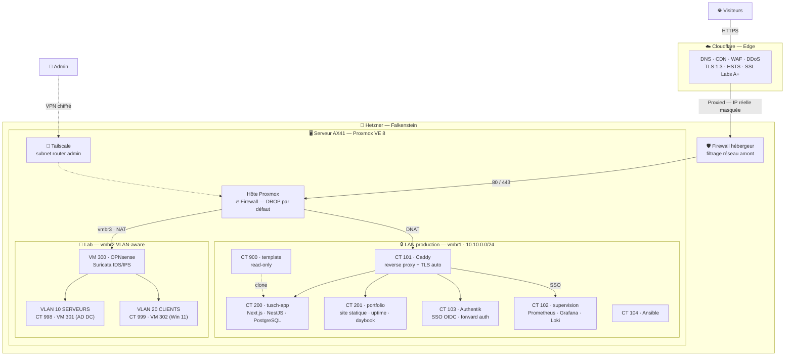

# Vue globale

Document d'entrée de la documentation d'architecture. Il donne la vue
d'ensemble de l'infrastructure ; les couches sont détaillées dans les documents
suivants ([réseau](02-reseau.md), [sécurité](03-securite.md),
[stockage](04-stockage.md)).

---

## Objectif

Une infrastructure auto-hébergée, sécurisée et reproductible, qui sert à la
fois de plateforme d'hébergement (dont le projet tusch.mn) et de terrain
d'apprentissage des compétences d'administration systèmes, réseaux et sécurité.

> Principe directeur : rester **simple, protégé et reproductible**. Chaque choix
> privilégie la clarté et la maintenabilité plutôt que la complexité.

---

## Le serveur

| | |
|---|---|
| **Modèle** | Serveur dédié Hetzner AX41-NVMe |
| **CPU** | AMD Ryzen 5 3600 — 6 cœurs / 12 threads |
| **RAM** | 64 Go |
| **Disques** | 2 × 512 Go NVMe, **RAID 1** logiciel (mdadm) |
| **Datacenter** | Falkenstein (Allemagne) |
| **OS hôte** | Debian 12 Bookworm |
| **Hyperviseur** | Proxmox VE 8 |

Le RAID 1 (miroir) garantit que la panne d'un disque ne provoque pas de perte
de données.

---

## Architecture en couches

---

## Composants et rôles

| Couche | Composant | Rôle |
|--------|-----------|------|
| Edge | Cloudflare | DNS, CDN, WAF, DDoS, TLS edge |
| Réseau | Firewall hébergeur | Filtrage en amont du serveur |
| Hyperviseur | Proxmox VE 8 | Virtualisation (LXC), firewall, stockage |
| Reverse proxy | CT 101 · Caddy | Routage HTTPS, TLS automatique |
| Application | CT 200 · tusch-app | Next.js + NestJS + PostgreSQL |
| Vitrine | CT 201 · portfolio | Site statique, endpoint d'uptime, outil perso protégé par SSO |
| Supervision | CT 102 · monitoring | Prometheus, Alertmanager, Grafana, Loki |
| Identités | CT 103 · Authentik | SSO OIDC, *forward auth* |
| Automatisation | CT 104 · Ansible | Nœud de contrôle Ansible |
| Template | CT 900 | Modèle de conteneur read-only (clonage) |
| Lab segmentation | VM 300 · OPNsense, CT 998/999 | VLANs, firewall inter-VLAN, Suricata |
| Lab Windows | VM 301 · contrôleur de domaine, VM 302 · poste client | Active Directory |
| Admin | Tailscale | Accès d'administration chiffré, hors-bande |

Inventaire détaillé (IP, ports, domaines, ressources) :
[`09-inventaire.md`](09-inventaire.md).

---

## Stack technique

| Domaine | Choix |
|---------|-------|
| Hyperviseur | Proxmox VE 8 (édition no-subscription) |
| OS hôte | Debian 12 Bookworm |
| Stockage | RAID 1 (mdadm) + LVM-thin sur loopback (snapshots LXC) |
| Conteneurisation | LXC (Linux) + KVM (OPNsense, lab Windows Server / Windows 11) |
| Reverse proxy | Caddy 2 (TLS automatique) |
| Segmentation réseau | OPNsense — VLANs 802.1Q, Kea DHCP, firewall directionnel |
| IDS/IPS | Suricata sur OPNsense (mode inline Netmap, rulesets ET Open) |
| Supervision | Prometheus + Grafana + Alertmanager (notifications Telegram) |
| Logs | Loki + Grafana Alloy (rétention 31 jours) |
| Sauvegardes | vzdump + restic chiffré vers Hetzner Storage Box (7 j / 4 sem. / 3 mois), restauration testée |
| Automatisation | Ansible (CT de contrôle dédié) |
| Identités (IAM) | Authentik — IdP OIDC/SAML/LDAP, SSO (Docker dans LXC dédié) |
| VPN admin | Tailscale |
| CDN / WAF | Cloudflare |
| Pare-feu | Firewall hébergeur + firewall Proxmox (DROP par défaut) |

---

## Sécurité — défense en profondeur

Sept couches de sécurité indépendantes, de l'edge à l'accès admin
hors-bande, jusqu'au contrôle d'accès centralisé (IAM). Le détail est dans [`03-securite.md`](03-securite.md).

L'idée centrale : **si une couche tombe, les autres protègent.**

---

## Documentation détaillée

| Document | Contenu |
|----------|---------|
| [`02-reseau.md`](02-reseau.md) | Bridges WAN/LAN, NAT, DNAT, plan d'adressage |
| [`03-securite.md`](03-securite.md) | Les couches de défense en profondeur |
| [`04-stockage.md`](04-stockage.md) | LVM-thin sur loopback, snapshots LXC |
| [`05-segmentation-vlan.md`](05-segmentation-vlan.md) | VLANs 802.1Q derrière OPNsense, politique inter-VLAN |
| [`06-ids-ips-suricata.md`](06-ids-ips-suricata.md) | Suricata en mode inline (IDS puis IPS) |
| [`07-supervision.md`](07-supervision.md) | Prometheus + Grafana + Alertmanager + Loki |
| [`08-identites.md`](08-identites.md) | Authentik (IdP/SSO), OIDC Grafana, firewall par-CT |
| [`09-inventaire.md`](09-inventaire.md) | État réel : CT, VM, IP, ports, domaines, sauvegardes |
| [`../pieges-resolus.md`](../pieges-resolus.md) | Problèmes rencontrés et résolus |
| [`../../proxmox/`](../../proxmox/) | Configurations Proxmox (réseau, firewall, systemd) |
| [`../../caddy/`](../../caddy/) | Configuration du reverse proxy |
| [`../../monitoring/`](../../monitoring/) | Configurations Prometheus, règles d'alerte, Loki |
| [`../../ansible/`](../../ansible/) | Inventaire et playbooks Ansible |

---

## État et perspectives

**En place** : virtualisation Proxmox, réseau segmenté (WAN/LAN privé), reverse
proxy HTTPS (A+ SSL Labs), défense en profondeur multi-couches, stockage avec
snapshots, accès admin via VPN, **segmentation par VLAN avec firewall
directionnel inter-VLAN (OPNsense)**, **IDS/IPS Suricata** en mode inline avec
blocage validé, **supervision Prometheus + Grafana + Alertmanager** avec
notifications Telegram. Accès admin direct par **subnet router Tailscale** et **SSO
centralisé Authentik** (Grafana en OIDC, *forward auth* sur une application
sans SSO natif). **Logs centralisés** (Loki + Alloy), **sauvegardes
quotidiennes chiffrées hors serveur** (vzdump + restic, restauration testée), premier playbook
**Ansible**, et un **lab Active Directory** (Windows Server + Windows 11) dans
les VLANs du lab.

**À venir** : généralisation
d'Ansible (déploiement des CT, durcissement), SIEM (Wazuh), collecte de logs
étendue à l'hôte et à l'application.